# ESP Web Framework

A reusable firmware library that turns an **ESP8266 NodeMCU**, an **ESP32 DevKit** or an **ESP32-S3** into a self-hosted web controller. Add it to a PlatformIO project, list your hardware in the browser, and you get a live dashboard, a REST and WebSocket API, and an automation engine that runs on the board with no browser open. No cloud, no CDN, no app to install.

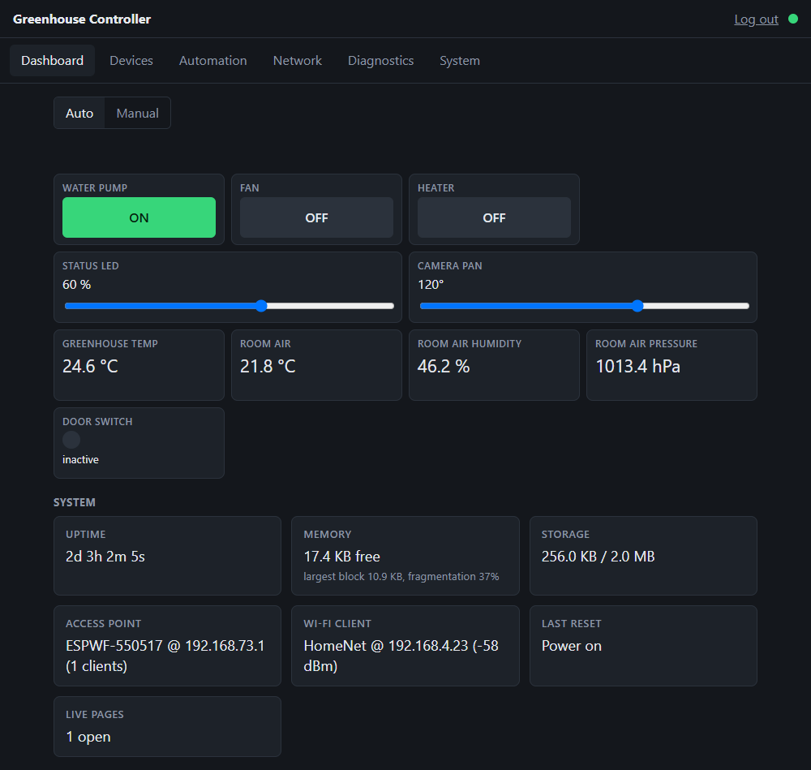

- [Features](#features)
- [Quick start](#quick-start)
- [Tour of the web interface](#tour-of-the-web-interface)
- [Running on an ESP32](#running-on-an-esp32)
- [Supported hardware and devices](#supported-hardware-and-devices)
- [Example apps](#example-apps)
- [Documentation](#documentation)
- [Safety](#safety)
- [Project status](#project-status)
- [Development](#development)
- [License](#license)

## Features

- **Wi-Fi setup in the browser.** The board starts its own access point, joins your home network, or does both. The dashboard is plain HTML/JS gzipped into the board's filesystem.
- **Device registry with drivers.** Relay, input, PWM, DC motor, servo (direct or through a PCA9685), DS18B20, BME280 and Parallax PING))) ultrasonic sensors, and a serial port. Add, edit, disable and remove devices from the page; pins are checked for conflicts and boot-sensitive GPIOs.
- **Dashboard that builds itself.** Auto mode makes a control for every device. Manual mode gives you a layout editor with toggles, sliders, joysticks, gauges, graphs, dropdowns, timers, tabs and more.
- **Automation on the board.** Rules (trigger, conditions, actions), timed sequences, countdown timers, and relay interlocks. They keep running with no browser open. Time-of-day schedules use NTP.
- **APIs.** REST under `/api/v1` and a WebSocket at `/ws` for live state, both documented and frozen for 1.x.
- **Network integrations.** Optional mDNS name (`http://<name>.local`), MQTT publish and subscribe, and a master / slave mode (ESP32 family) where a board's buttons control another board over REST. All off by default.
- **Safety nets.** Per-device failsafes with a dashboard heartbeat, per-device enable/disable, a hardware watchdog, login lockout, diagnostics and an event log.
- **Maintenance built in.** Admin password with sessions, authenticated over-the-air firmware update (MD5 checked), JSON config on LittleFS with export, import and factory reset.

LAN only. Plain HTTP with one shared admin password: not for the internet. See [Safety](#safety).

## Quick start

An app is its own small PlatformIO repo that pins this library by tag.

**1. `platformio.ini`**

```ini
[env]
extra_scripts = pre:tools/build_ui.py
lib_deps =
    https://github.com/spinsycle/espwebframework.git#v1.0.1
    esp32async/ESPAsyncWebServer@3.12.1
    bblanchon/ArduinoJson@7.4.3
    paulstoffregen/OneWire@2.3.8
    marvinroger/AsyncMqttClient@0.9.0

[env:nodemcuv2]
platform = espressif8266@4.2.1
board = nodemcuv2
framework = arduino
board_build.filesystem = littlefs
lib_deps = ${env.lib_deps}
    esp32async/ESPAsyncTCP@2.0.0

[env:esp32dev]
platform = espressif32@6.9.0
board = esp32dev
framework = arduino
board_build.filesystem = littlefs
lib_deps = ${env.lib_deps}
    esp32async/AsyncTCP@3.5.0
```

Copy [`tools/build_ui.py`](tools/build_ui.py) into your app's `tools/` folder. It packs the dashboard into the filesystem image.

**2. `src/main.cpp`**

```cpp
#include <Framework.h>
FrameworkController Framework;

void setup() { Framework.setDeviceName("My Device"); Framework.begin(); }
void loop()  { Framework.loop(); }
```

**3. Flash** (close any serial monitor first; the second command wipes saved settings)

```bash
python -m platformio run -e nodemcuv2 -t upload
python -m platformio run -e nodemcuv2 -t uploadfs
```

Use `-e esp32dev` for an ESP32 or `-e esp32s3` for an ESP32-S3.
**4. Sign in.** Join the board's Wi-Fi `ESPWF-xxxxxx` (password `espframework`), open `http://192.168.73.1`, sign in with the factory password, and choose a new one. Then add your home Wi-Fi on the Network tab and start adding devices.

Full walkthrough: [docs/INSTALL.md](docs/INSTALL.md). The fastest way in is to copy an [example app](#example-apps).

## Tour of the web interface

The screenshots show a demo board called "Greenhouse Controller". Yours starts empty. The [user guide](docs/USER_GUIDE.md) explains every screen in detail.

### Sign in and first-run password change

A fresh board forces you to replace the factory password before anything else works.

| Sign in | Choose a password |
|---|---|
|  | 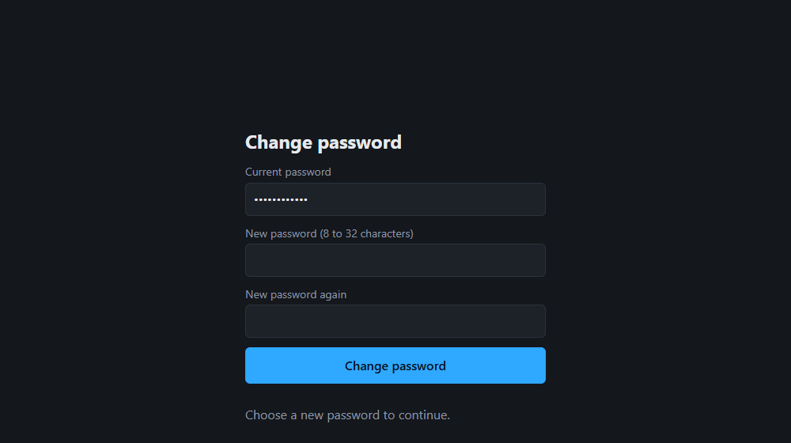 |

### Dashboard: automatic or hand-built

In **Auto** mode every device gets the right control. In **Manual** mode you place, resize and configure components, split them into tabs, preview, and save the layout to the board.

| Auto layout | Layout editor |
|---|---|
|  | 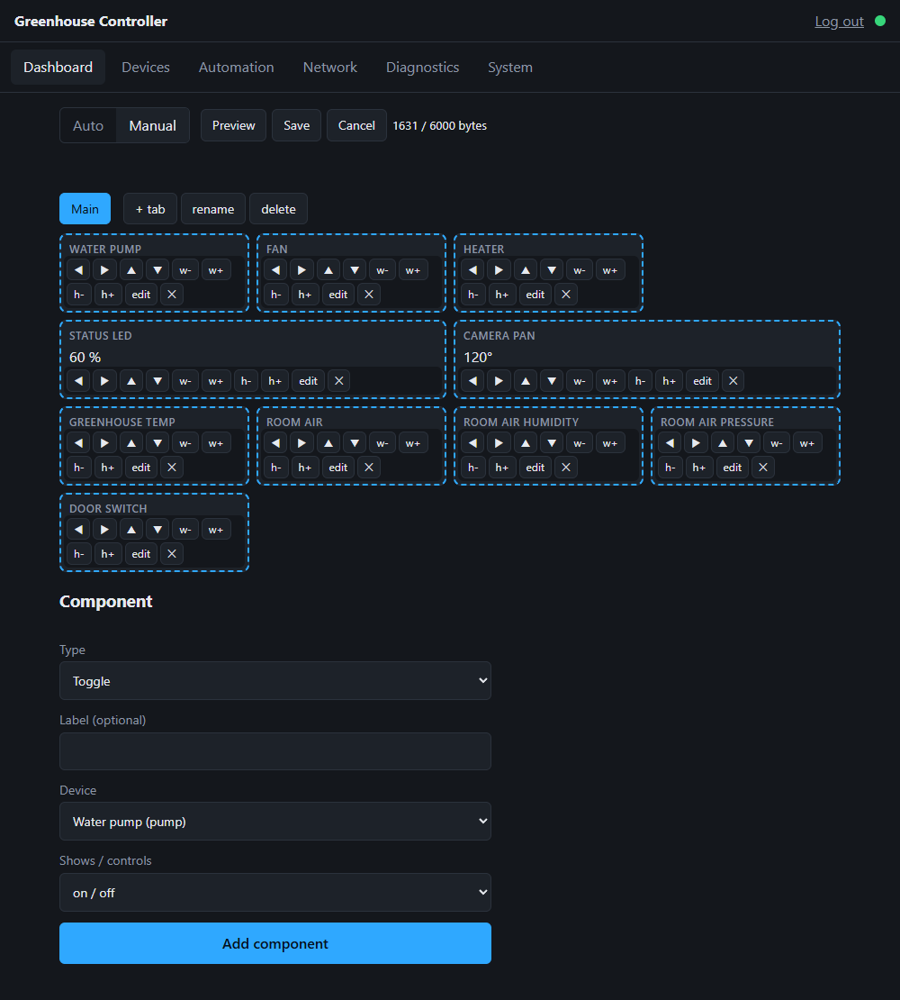 |

### Devices

Add, edit, disable and remove devices. Each card has a live control. The form only shows fields that apply to the chosen type, and the board refuses bad pins with a named error. An I2C scanner finds sensor addresses.

| Device list | Add a device (PCA9685 servo) |
|---|---|
| 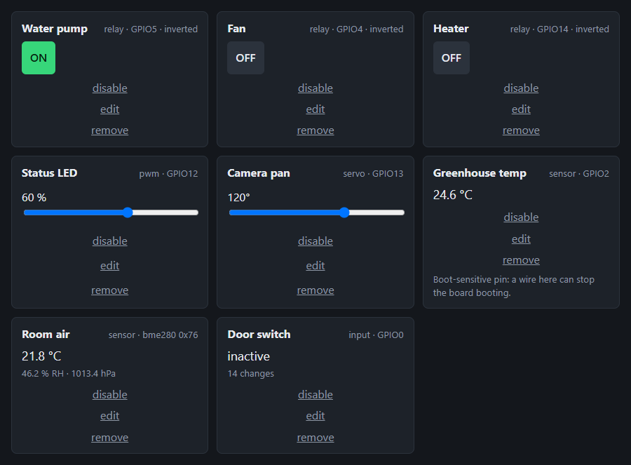 | 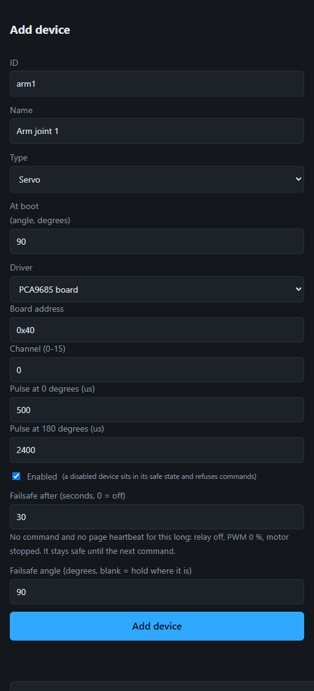 |

### Automation

Rules read as "when, only if, then". Triggers include value changes, conditions becoming true for N seconds, intervals, times of day, boot, Wi-Fi events, and timer and sequence completion. Sequences, timers and interlocks live on the same tab.

| Rules, sequences, timers | Rule editor |
|---|---|
| 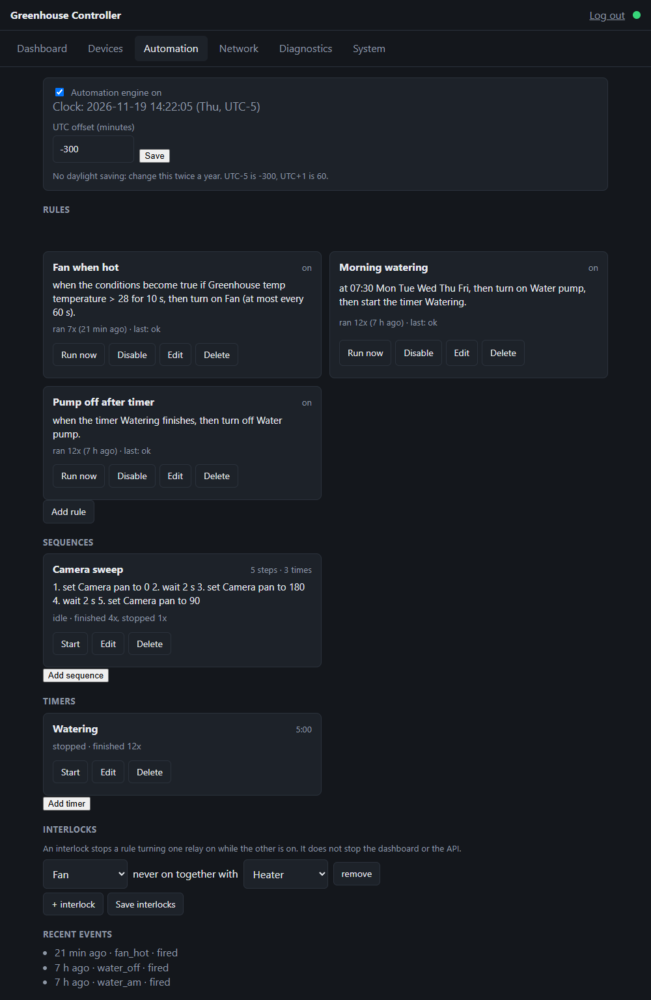 | 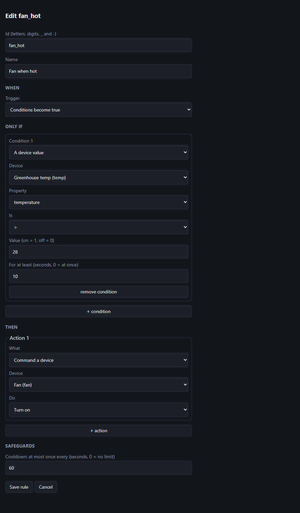 |

### Network, diagnostics and system

| Network | Diagnostics | System |
|---|---|---|
| 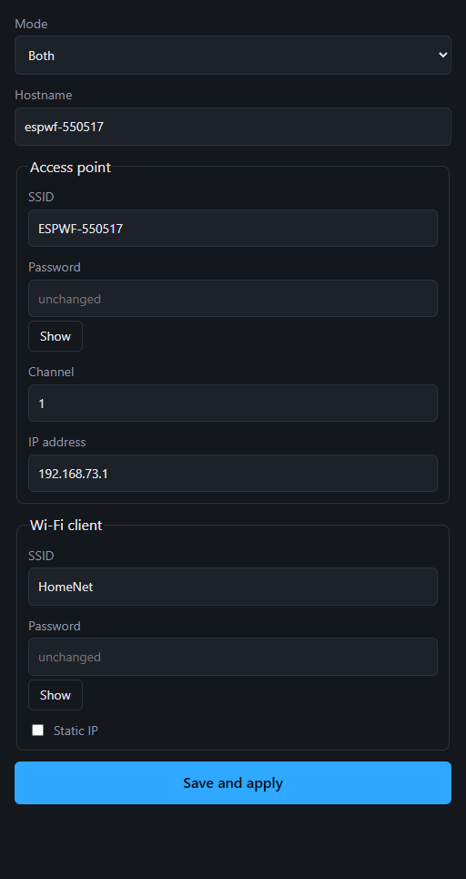 | 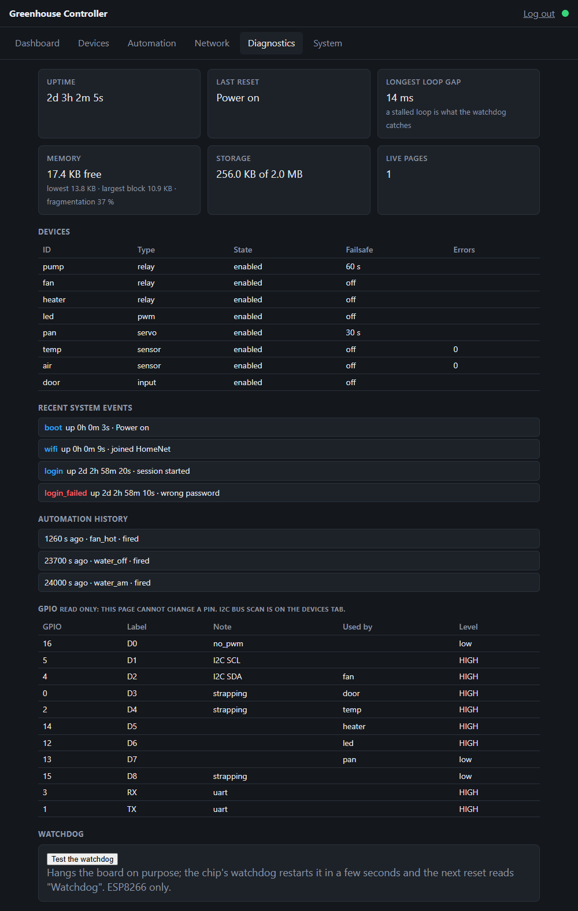 | 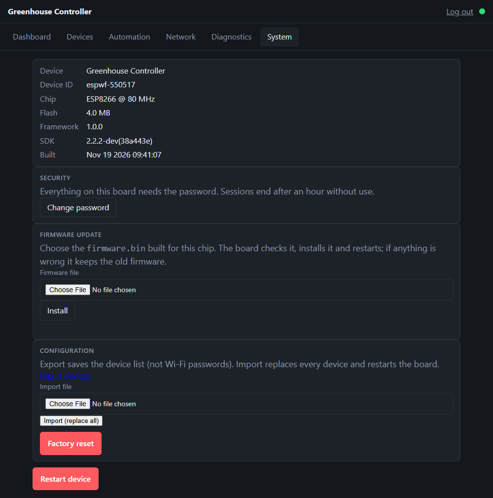 |

- **Network**: access point only, join existing Wi-Fi, or both (recommended), with optional static IP.
- **Diagnostics**: last reset reason, memory and fragmentation, device health and failsafe state, event log, automation history, and a GPIO map showing which device owns each pin.
- **System**: chip info, password change, OTA firmware update, device export and import, factory reset, restart.

### On a phone

The page is responsive, so a phone or tablet is the controller in the field.

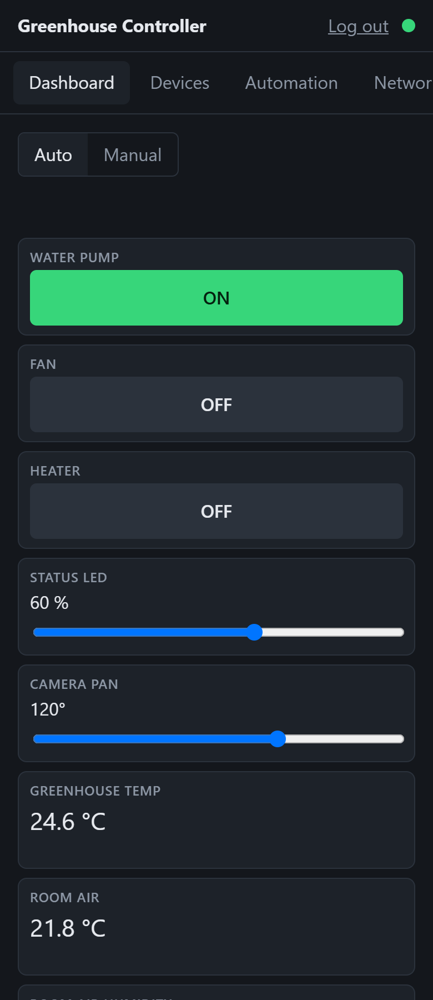

## Running on an ESP32

The same firmware and the same page run on an **ESP32 DevKit (WROOM-32)**. These screenshots are from a real board, flashed with `-e esp32dev` and reached over its home-network address (network name, address and chip ID masked). The board has one device, a direct servo on GPIO 18, and its slider appears on the dashboard by itself. The add-device form already offers the new Parallax PING))) sensor (shown filled in, not submitted: no sensor was connected). The System and Diagnostics shots were taken before the servo was added, so their device lists are empty.

| Dashboard | Devices |
|---|---|
| 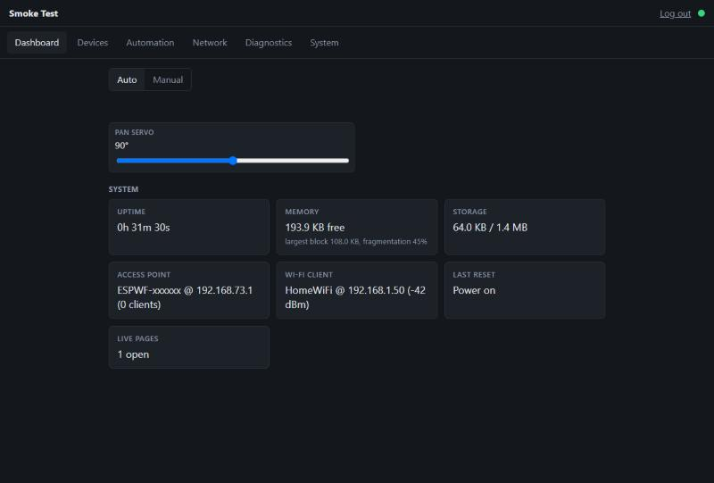 | 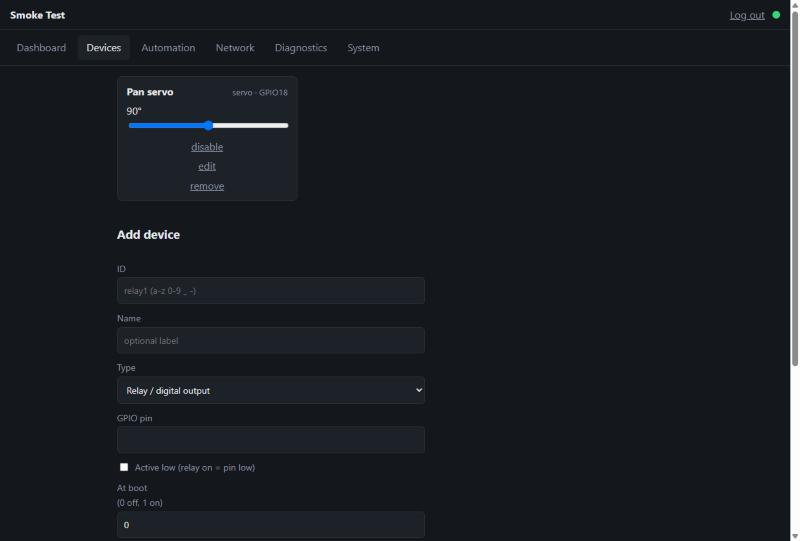 |

| Add a PING))) sensor | System: chip ESP32 @ 240 MHz |
|---|---|
| 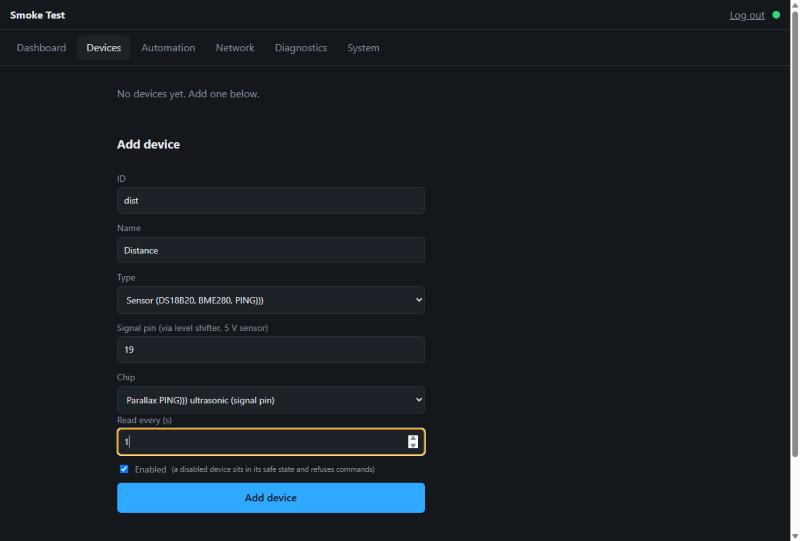 | 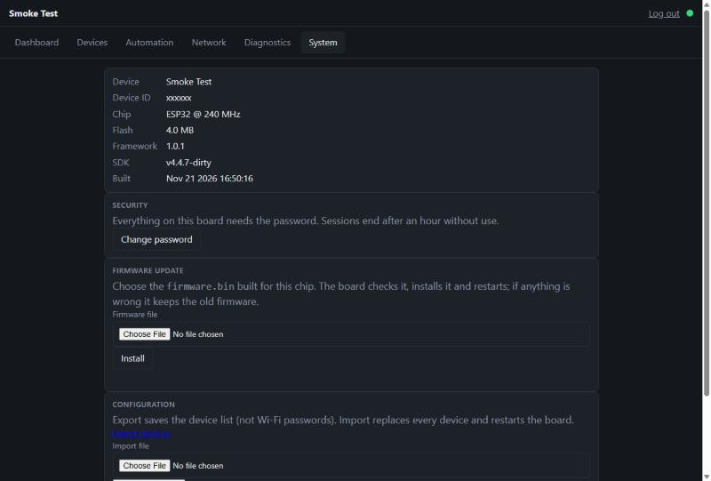 |

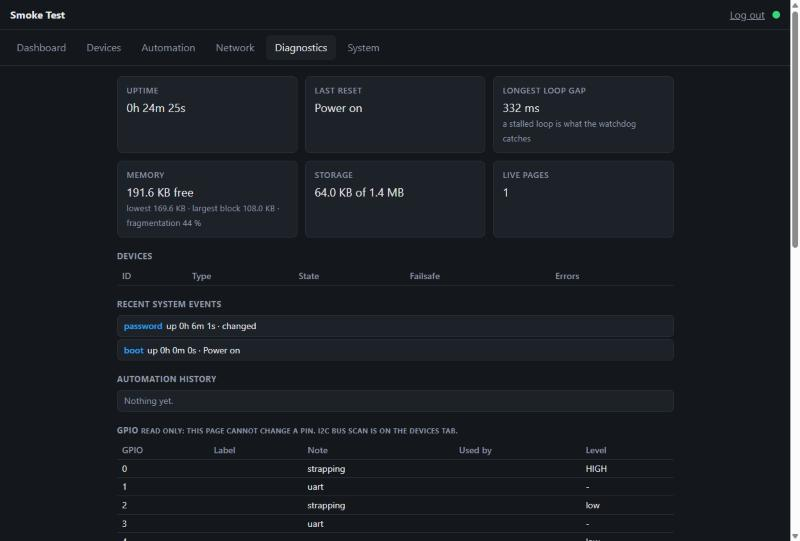

What has been checked on the ESP32: it boots, serves the dashboard, joins Wi-Fi and runs the device registry (the servo was added from the page). The servo's physical movement was not recorded in these shots. What has not: the PING))) sensor reading a real distance (the driver is built and tested natively, but no sensor has been connected to the board yet), the per-phase hardware checklists row by row, and a long soak (the ESP8266 had both). The ESP32-S3 target is compile-checked only. See [Project status](#project-status).

## Supported hardware and devices

| | ESP8266 (NodeMCU) | ESP32 (DevKit WROOM-32) | ESP32-S3 (DevKitC-1) |
|---|---|---|---|
| Devices | 16 | 32 | 32 |
| PWM-timed outputs (PWM, motor, direct servo) | 8 | 8 | 8, one shared frequency |
| Sessions signed in / live WebSocket pages | 3 / 3 | 3 / 3 | 3 / 3 |
| MQTT, mDNS | yes | yes | yes |
| Master / slave (a board whose buttons control another board) | no, always a master (not enough RAM) | yes | yes |

| Device type | Notes |
|---|---|
| Relay | Active-low option, boot state, failsafe |
| Input | Digital input, status light |
| PWM | Sliders, LEDs, fans |
| Motor | H-bridge, signed speed, stop, failsafe |
| Servo | Direct or via PCA9685, per-servo pulse calibration |
| Sensors | DS18B20 (1-Wire), BME280 (I2C: temperature, humidity, pressure), Parallax PING))) ultrasonic (one signal pin, distance in cm; 5 V part, needs a level shifter) |
| Serial | One text port, send and receive |

Automation limits: 16 rules (3 conditions, 4 actions each), 4 interlocks, 4 sequences (32 steps in all), 6 timers. Dashboard: 32 components, 6 tabs. Details in [docs/DRIVERS.md](docs/DRIVERS.md) and the [user guide](docs/USER_GUIDE.md#10-limits).

## Example apps

Each example is a complete app: `platformio.ini`, one `main.cpp`, and a `seed/` folder that ships its devices and rules with `uploadfs`, so a fresh board boots already configured. Flash with `uploadfs` then `upload` (see [Quick start](#quick-start)); `uploadfs` resets the password to `espframework`.

| Example | What it shows | Parts |
|---|---|---|
| [`relay_controller`](examples/relay_controller) | The smallest complete app. A button toggles a lamp; a schedule turns it on at 18:00 and off at 23:00. | 1 relay, 1 push button |
| [`light_sequencer`](examples/light_sequencer) | The automation engine: a repeating LED fade sequence, a countdown timer, and a startup rule. | 1 LED, 1 relay |
| [`thermostat`](examples/thermostat) | Sensor-driven control with hysteresis: heat on below 20 C, off above 22 C, heater off if the sensor fails. | DS18B20, 1 relay |
| [`pan_tilt_rover`](examples/pan_tilt_rover) | Drive and aim from the dashboard; failsafes stop the motor and re-centre the servos. | DC motor + H-bridge, 2 servos, PCA9685 |

[`examples/smoke`](examples/smoke) is the build and test harness used by the gate, not a demo.

## Documentation

| Document | Read it to |
|---|---|
| [Install and first run](docs/INSTALL.md) | Set up PlatformIO, create an app, flash a board, sign in for the first time, update firmware later |
| [User guide](docs/USER_GUIDE.md) | Use the interface: dashboard, devices, automation, network, diagnostics, system, phone use, limits, troubleshooting (with screenshots) |
| [Device drivers](docs/DRIVERS.md) | See every device type, its fields, and how to add a new driver |
| [Configuration reference](docs/CONFIG.md) | Understand the JSON config files, the automation format and seeding an app |
| [API reference](docs/API.md) | Call every REST route and WebSocket message from your own code |
| [Safety and known limits](docs/SAFETY.md) | Know what the software does not protect against, and the known stability limits |
| [Changelog](CHANGELOG.md) | See what changed in each release |

## Safety

Read [docs/SAFETY.md](docs/SAFETY.md) before connecting anything that can hurt someone or something.

- Failsafes, interlocks and the enable switch are conveniences, **not electrical protection**. Mains loads, motors and heaters need their own fuse, thermal cut-out and hardware interlock.
- There is no HTTPS and one shared password. Keep the board on a trusted LAN; never forward a port to it.
- Interlocks only guard against automation rules, not the dashboard or the API.
- Failsafes need an open, visible dashboard page (or an API client) sending heartbeats.

## Project status

Latest release 1.0.1; the `main` branch also carries mDNS, MQTT, master / slave, ESP32-S3 support and the PING))) sensor (see the [changelog](CHANGELOG.md), "Unreleased"). Verified on an ESP8266 NodeMCU: every build phase passed its hardware checklist. It has also been run on an ESP32 DevKit (boots, serves the dashboard, the device registry works; the PING))) sensor has not been tried on hardware yet), but the per-phase ESP32 checklists are not ticked row by row and there has been no ESP32 soak. The ESP32-S3 build compiles and passes the native tests but has not been run on a board. Two 24-hour soak runs (on the ESP8266) showed a flat heap but occasional external resets and HTTP stalls that recovered by themselves; the cause is not pinned down and is written up in the [changelog](CHANGELOG.md) and [safety notes](docs/SAFETY.md). The `/api/v1` surface and the `schema_version` 1 config format are frozen: additions only.

## Development

Run these from a checkout of this repository.

| Command | Does |
|---|---|
| `powershell -File tools/gate.ps1` | Builds all three targets, every example and the filesystem images, and runs the native tests |
| `python tools/mutate_devices.py` | Mutation check of the device logic |
| `python tools/check_frozen.py` | Fails if a frozen API item was removed or renamed |
| `tools/api_smoke.ps1 -Ip <address> -Password <pw>` | Exercises the whole API on a live board (about 4 minutes) |
| `python tools/soak.py` | Logs a long polling run |

Layout: `src/` firmware library, `ui/` the dashboard, `test/` native tests, `examples/` demo apps, `docs/` documentation and screenshots, `tools/` build and test scripts.

## License

[MIT](LICENSE)
