# ESP Web Framework: user guide

How to use a board that runs the framework: sign in, add devices, build a dashboard, automate, and keep it healthy. For building and flashing an app see [INSTALL.md](INSTALL.md); for the REST API see [API.md](API.md).

The screenshots show a demo board called "Greenhouse Controller" with a few made-up devices. Yours starts empty.

- [1. First sign-in](#1-first-sign-in)
- [2. The page at a glance](#2-the-page-at-a-glance)
- [3. Dashboard](#3-dashboard)
- [4. Devices](#4-devices)
- [5. Automation](#5-automation)
- [6. Network](#6-network)
- [7. Diagnostics](#7-diagnostics)
- [8. System](#8-system)
- [9. Using it from a phone](#9-using-it-from-a-phone)
- [10. Limits](#10-limits)
- [11. Troubleshooting](#11-troubleshooting)

## 1. First sign-in

A freshly flashed board starts its own Wi-Fi network named `ESPWF-` plus six characters, password `espframework`.

1. Join that network on your PC or phone.
2. Open `http://192.168.73.1`.
3. Type the factory password `espframework` and press **Sign in**.

The board will not let you do anything else until you replace the factory password. Pick 8 to 32 printable characters and type it twice.

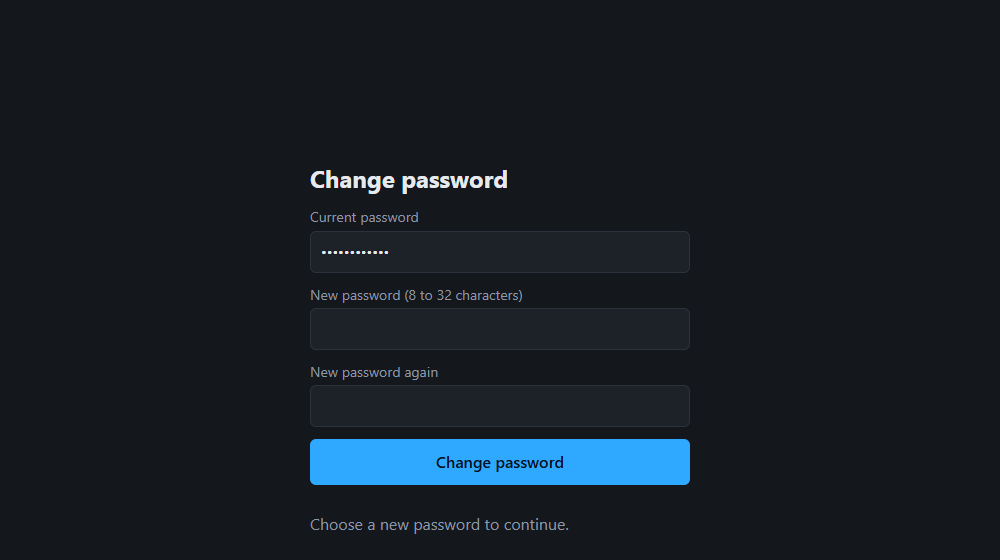

Good to know:

- The password is one shared admin password. There are no user accounts.
- At most 3 browsers can be signed in at once. A session ends after an hour without use, when you log out, or when the board restarts.
- Five wrong passwords in a row lock sign-in for a short time; the page shows how many seconds.
- Changing the password signs every other browser out.

**Next step: join your home Wi-Fi.** Open the **Network** tab (section 6), enter your Wi-Fi name and password, choose mode **Both**, and save. The board's own network stays as a way back in. Its address on your network appears on the Dashboard under **Wi-Fi client**, and the board also answers to its hostname (`espwf-` plus six characters).

## 2. The page at a glance

Six tabs run along the top. The coloured dot at the top right is green while the page is talking to the board and grey when it is not. **Log out** is next to it.

| Tab | What it is for |
|---|---|
| Dashboard | Control and watch your devices; edit the layout |
| Devices | Add, edit, disable and remove devices; scan the I2C bus |
| Automation | Rules, sequences, timers, interlocks, the clock |
| Network | Access point and home Wi-Fi settings |
| Diagnostics | Memory, resets, device health, event log, pin map |
| System | Chip info, password, firmware update, export, import, reset |

## 3. Dashboard

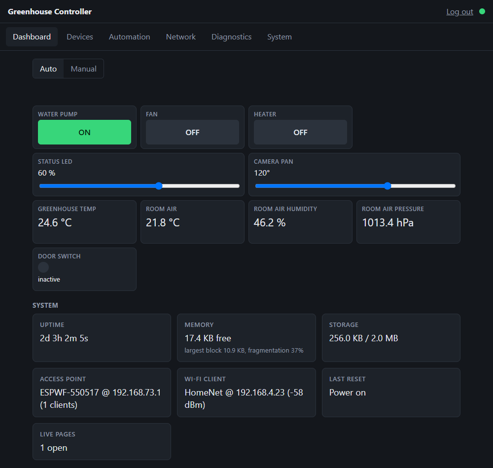

The top of the page is your controls. Below them, **System** cards show uptime, free memory, storage, the access point, the Wi-Fi client link, the last reset reason and how many pages are connected live.

### Automatic layout

In **Auto** mode the dashboard builds itself from the device list. Add a device and its control appears.

| Device | Control |
|---|---|
| Relay | ON / OFF toggle button |
| PWM, servo | Slider |
| Motor | Slider (negative = reverse) plus a Stop button |
| Temperature or pressure sensor | Number display (a BME280 gets three: temperature, humidity, pressure) |
| Input | Status light |
| Serial device | Device card with a text box |

Sliders send values live while you drag.

### Manual layout

Press **Manual** to design your own. If nothing is saved yet it starts from the automatic layout, so you only change what you want.

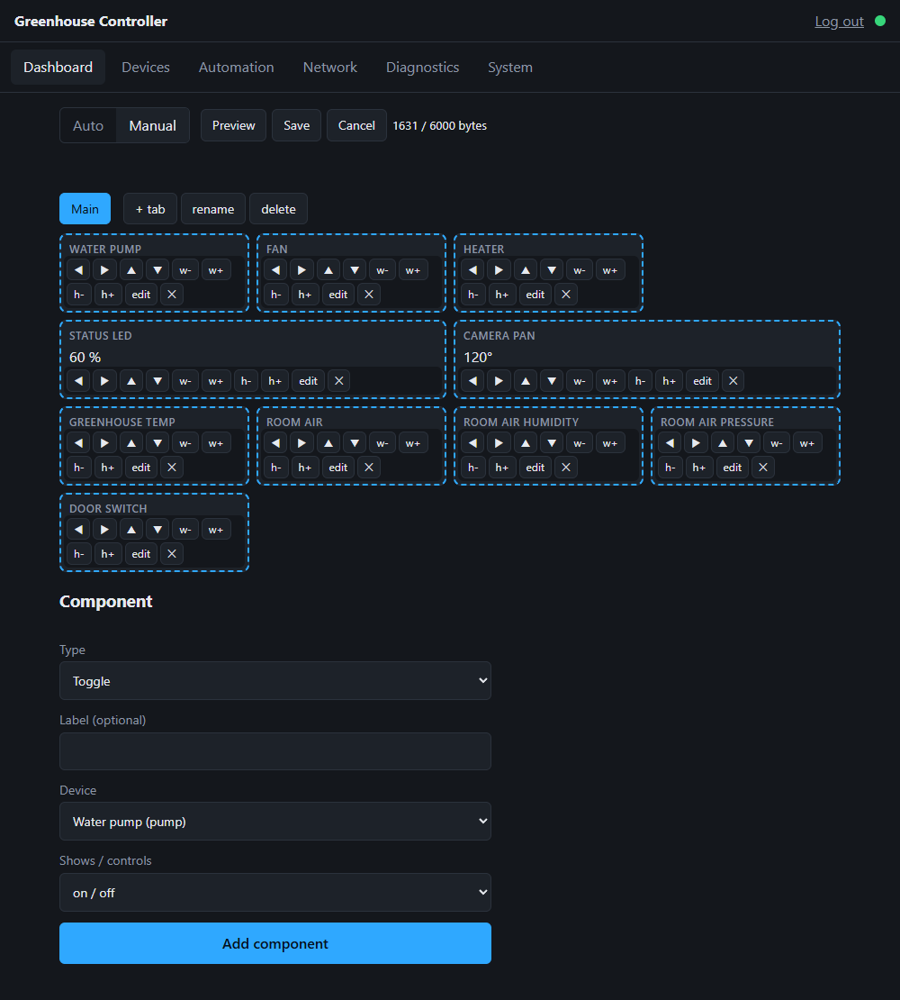

Every component grows a small toolbar:

- Arrows move it on a 4-column grid. `w-` `w+` change its width; `h-` `h+` its height. A move that would overlap another component or leave the grid is ignored.
- **edit** loads it into the **Component** form below; **✕** deletes it.
- The **Component** form adds new ones: pick a type, a device, and what it shows or controls, then **Add component**.
- **+ tab**, **rename** and **delete** manage pages. A dashboard with one page shows no tab bar.
- **Preview** shows it as it will look, live and clickable. **Save** stores it on the board. **Cancel** throws your edits away.

The counter beside the buttons (for example `1631 / 6000 bytes`) is how much of the board's storage budget the layout uses. Save is refused above 6000.

Component types:

| Type | Use |
|---|---|
| Toggle | On/off for a relay |
| Push button | Fire one fixed command: toggle, set a value, stop, send text |
| Slider | Set PWM, motor or servo level |
| Joystick | Two devices on X and Y; springs back to centre, so a motor stops |
| Gauge, Number display, Progress bar | Show a sensor or level |
| Status light | Show an input or "reading ok" |
| Graph | The last minute of a value |
| Text display | Last line received on a serial device |
| Dropdown | Pick from named values you type as `Label=value` lines |
| Device card | The full card from the Devices tab |
| Group panel | Several device cards in one box |
| Timer | Countdown with Start/Stop for an automation timer |

The firmware checks every layout against your real devices, and refuses one that points at a device that does not exist. If you later remove a device, its component turns red and says what is missing.

**Auto** returns to the automatic layout. Your manual layout stays stored, so pressing **Manual** brings it back.

> While any dashboard page is open and visible it sends a heartbeat every second. That heartbeat is what keeps device failsafes from tripping (section 4). A hidden tab or a closed page stops it.

## 4. Devices

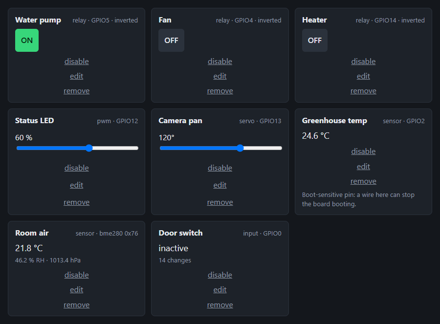

Each card shows the device, its pin, and a live control. Under it:

- **disable** / **enable**: a disabled device sits in its safe state, refuses commands and stops reading. Handy for wiring work.
- **edit**: loads the device into the form below. The ID and type are fixed; everything else can change. Saving restarts that device.
- **remove**: asks, then deletes.

A warning appears on a pin that can stop the board booting (GPIO 0, 2 and 15 on an ESP8266). Do not wire anything to those pins that pulls them the wrong way at power-up.

### Add a device

Scroll down to **Add device**. The fields that apply to the chosen type are the only ones shown.

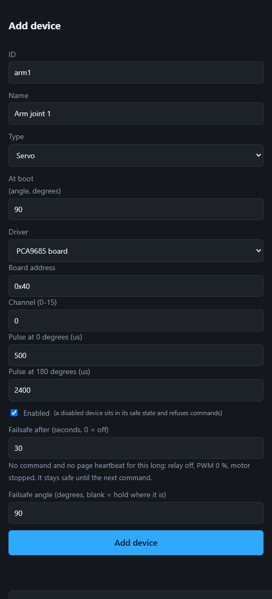

1. **ID**: short, lowercase letters, digits, `_` or `-` (up to 16). Rules and the API refer to it, so choose it once.
2. **Name**: the label people see.
3. **Type**: relay, input, PWM, motor, servo, sensor, or serial.
4. Fill in the pins and options, then **Add device**.

If the board refuses, the message under the button names the problem, for example `pin_in_use` or `pin_reserved`. Typical fields per type are in [DRIVERS.md](DRIVERS.md). The ones people trip on:

- **Relay modules are usually active low.** Tick **Active low** so ON means the relay clicks on.
- **Servo calibration.** Pulse at 0 and 180 degrees (`500` and `2400` by default) are tuning knobs. Adjust them per servo if it buzzes or stops short of its end.
- **PCA9685 servos and BME280 sensors use the I2C bus**, not a pin: pick the board address and channel instead.
- **Max 8 PWM-timed outputs** in total (PWM, motor, and directly driven servos).

### Failsafe

Relays, PWM, motors and servos have **Failsafe after (seconds)**. If no command and no page heartbeat arrive for that long, the device goes to its safe state: relay off, PWM 0 %, motor stopped, servo holds or moves to the **Failsafe angle**. It stays there until you send the next command. `0` turns the feature off. A device that tripped shows a warning on its card.

Use it for anything that must not run unattended, such as a pump or a robot drive.

### I2C scan

At the bottom of the Devices tab, **Scan bus** lists what answers on the I2C pins (SDA and SCL are shown). Use it to find a sensor's address.

## 5. Automation

Automation runs **on the board**. Rules, timers and sequences keep working with no browser open.

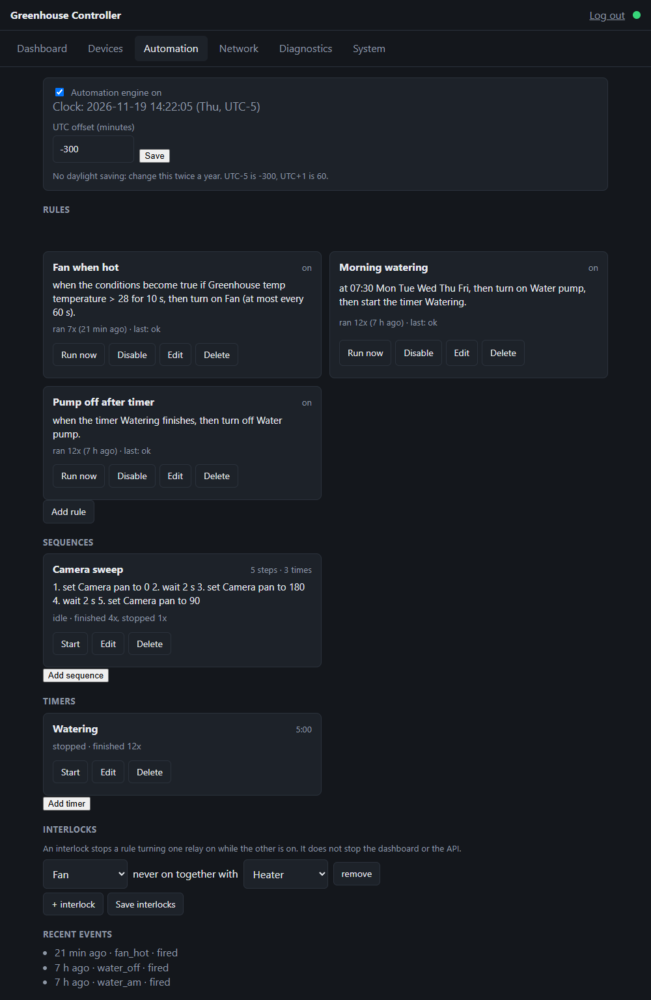

At the top:

- **Automation engine on** is the master switch.
- The clock line shows the board's time. The clock is set from the internet once the board has joined your Wi-Fi. Until then schedules and time windows do nothing, and the line turns into a warning.
- **UTC offset (minutes)**: set your time zone, for example `-300` for UTC-5 or `60` for UTC+1. There is no daylight saving adjustment, so change it twice a year.

### Rules

A rule reads as "**When** (trigger), **only if** (conditions), **then** (actions)". Each card shows it as a sentence, how many times it ran, and when.

**Add rule** opens the editor. **Run now** fires a rule by hand; **Disable**, **Edit** and **Delete** do what they say.

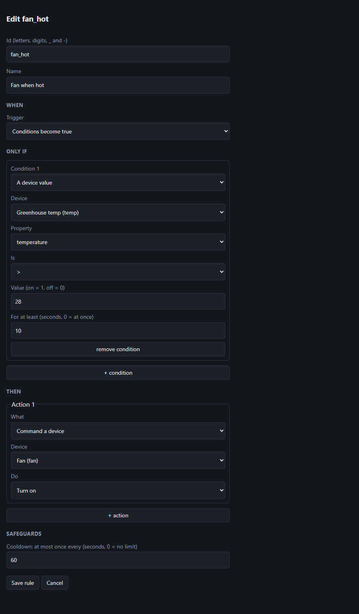

Triggers:

| Trigger | Fires |
|---|---|
| A value changes | Whenever the chosen device property changes |
| Conditions become true | The moment the conditions go from false to true (only this one supports "for at least N seconds") |
| Every so often | Every N seconds |
| At a time of day | At HH:MM on the days you tick (needs the clock) |
| When the board starts | Once, after boot |
| Wi-Fi connects or drops | On that event |
| Run by hand only | Only from **Run now** |
| A timer finishes | When the chosen timer ends |
| A sequence finishes or stops | When the chosen sequence ends |

Conditions compare a device value (`>`, `<`, `==`, and so on; for on/off use 1 and 0) or test a time window, which may cross midnight. With more than one, choose **all** (AND) or **any** (OR).

Actions: turn a relay on, off or toggle; set a PWM, motor or servo value; stop a motor; send text to a serial device; start or stop a timer or sequence; or send a named event that shows in the log. A rule may have up to 4 actions.

Safeguards:

- **Cooldown** limits how often a rule may fire.
- A built-in storm guard stops a rule that fires too fast.
- A rule that commands a failing device shows a failed count on its card.

Worked example, "Fan when hot" (the rule in the screenshot): trigger **Conditions become true**, condition *Greenhouse temp temperature > 28 for 10 s*, action *turn on Fan*, cooldown 60 s. A brief spike will not start the fan; a real heat-up will.

### Sequences

A sequence is an ordered list of steps that runs in the background: **do** an action (optionally only *if* a condition holds, otherwise skip or stop), **wait** N seconds, or **wait until** a condition becomes true (with a timeout, then carry on or stop). It can repeat a number of times or until stopped. A sequence that repeats must contain a wait step.

Cards offer **Start**, **Pause**, **Resume** and **Stop** depending on its state, and show "step 3 of 5" while running.

### Timers

A timer counts down once started, from its **Start** button, a rule, a sequence or a dashboard Timer component. **Start again by itself** makes it repeat. Rules can trigger when a timer finishes. Editing a timer stops it.

### Interlocks

An interlock says two relays are "never on together", for example a heater and a fan, or two directions of a motor wired through relays. A rule that tries to switch the second on while the first is on is refused. **Save interlocks** to apply.

> An interlock only protects against **rules**. The dashboard and the API can still switch both on. Do not rely on it as the only protection for something dangerous.

### Recent events

The list at the bottom, and the one on the Diagnostics tab, show what fired and when.

## 6. Network

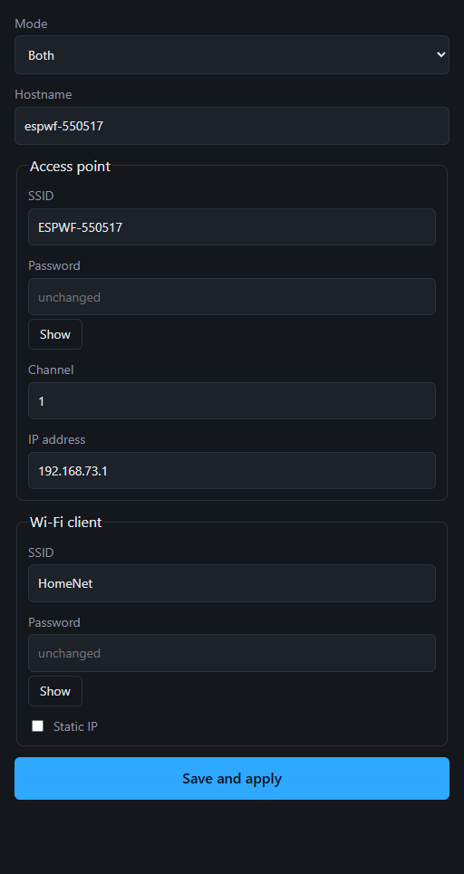

| Mode | Behaviour |
|---|---|
| Access point only | The board is its own Wi-Fi network |
| Join existing Wi-Fi | The board connects to your router |
| Both | Does both. Recommended: if the router is unreachable you can still get in |

Under **Access point** set the network name, password, channel and the board's address (`192.168.73.1` by default). Under **Wi-Fi client** set your router's name and password; tick **Static IP** to give it a fixed address (then fill in IP, gateway and mask).

Password boxes show `unchanged` when blank, and keep the current password. **Show** reveals what you typed, so check it before saving.

Press **Save and apply**. The board changes network after the reply goes out, so the page loses contact: reconnect to the board and open it again at its new address.

> **Typing a wrong access-point password can lock you out.** If you cannot reach the board in any mode, re-flash the filesystem (`uploadfs`), which returns it to the factory settings and the factory password.

## 7. Diagnostics

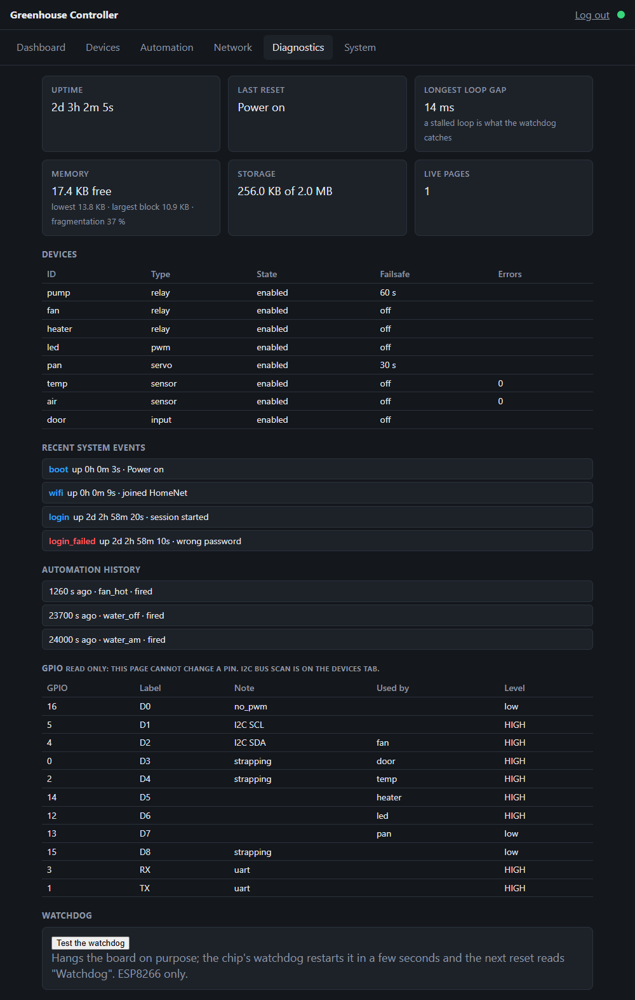

Read-only, updating every few seconds. Open it when something behaves oddly.

- **Last reset** says why the board last restarted. "Power on" or a restart you asked for are normal. A watchdog or fault reset is flagged with a note.
- **Longest loop gap** is the longest the main loop stalled. Large numbers mean something is blocking.
- **Memory** shows free, lowest ever, and largest block. A small largest block with high fragmentation is what runs the board out of room.
- **Devices** table: enabled state, failsafe setting (and `TRIPPED` if it fired), and read errors for sensors.
- **Recent system events**: boots, Wi-Fi joins, logins, failed logins, failsafe trips. Problems are in red.
- **Automation history**: the last rule events.
- **GPIO**: every pin with its NodeMCU label, notes (strapping, flash, UART), which device owns it and its level now. It cannot change a pin.
- **Test the watchdog** hangs the board on purpose so you can see a watchdog reset recover. ESP8266 only; it asks first.

## 8. System

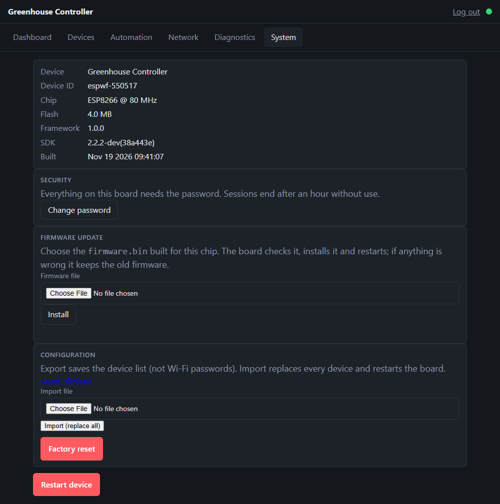

- **Chip info**: device name and ID, chip, flash size, framework version.
- **Security, Change password**: the same form as first sign-in.
- **Firmware update**: choose the `firmware.bin` built for this chip and press **Install**. The page checks it looks like a firmware image, the board verifies it with an MD5 checksum, installs, restarts, and the page reloads when the board is back. A bad or incomplete upload leaves the old firmware running. Settings are kept. Do not unplug the board during an update.
- **Configuration, Export devices** saves your device list to `espwf-config.json`. It leaves out Wi-Fi passwords, rules, sequences and the dashboard.
- **Import (replace all)** replaces every device with those in a file, then restarts. The file is checked first; if any device is bad, nothing changes and the message names which one.
- **Factory reset** deletes all saved settings (devices, Wi-Fi, password, rules, dashboard) and restarts the board in its own access point with the factory password. It asks first.
- **Restart device** does what it says. Outputs return to their boot state.

## 9. Using it from a phone

The page is responsive. Controls stack in one column and the tab bar scrolls sideways.

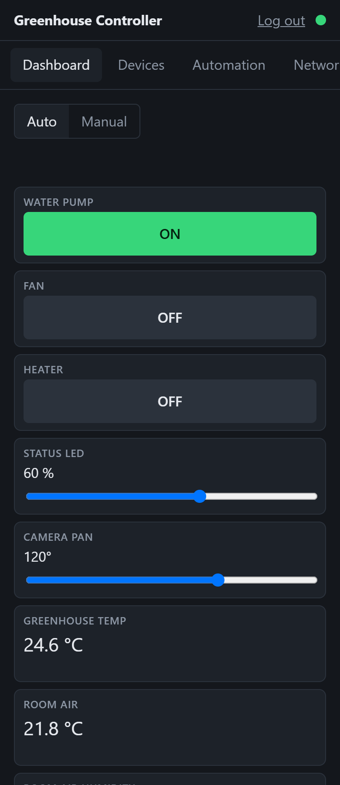

Both the phone and the board must be on the same network (or the phone joined to the board's own access point). Phone and tablet browsers are the controller in the field: keep the page open and visible while a device with a failsafe is running.

## 10. Limits

| | ESP8266 | ESP32 |
|---|---|---|
| Devices | 16 | 32 |
| PWM-timed outputs (PWM, motor, direct servo) | 8 | 8 |
| Serial devices | 1 | 1 |
| Sessions signed in | 3 | 3 |
| Live (WebSocket) pages | 3 | 3 |

Automation: 16 rules, 3 conditions and 4 actions per rule, 4 interlocks, 4 sequences of up to 16 steps (32 steps in all), 6 timers. Dashboard: 32 components, 6 tabs, 6000 bytes.

The board is **LAN only**. It speaks plain HTTP with one shared password. Do not expose it to the internet. Read [SAFETY.md](SAFETY.md) before connecting anything that can hurt someone or something.

## 11. Troubleshooting

| Symptom | Try |
|---|---|
| Cannot find the `ESPWF-` network | Wait half a minute after power-up. If you saved the mode as **Join existing Wi-Fi**, the board's own network is off: use its address on your home network, or re-flash the filesystem |
| Sign-in says "Wrong password" | It is case sensitive. After a factory reset it is `espframework` |
| "Too many wrong passwords" | Wait the number of seconds the page shows |
| Lost the password, or locked out by a bad access-point password | Re-flash the filesystem (`uploadfs`): factory settings and factory password |
| Page loads but stays offline (grey dot) | The board restarted or lost Wi-Fi. It reconnects by itself within seconds |
| Board is slow to join your router, then fast on a phone hotspot | Router-side: try a separate 2.4 GHz network, WPA2 only, band steering off |
| The dashboard stalls for minutes, then recovers | A known limit seen in long soak tests (the board still answers pings, not HTTP); the cause is not pinned down. Power it from a wall adapter rather than a PC USB port. See [SAFETY.md](SAFETY.md) |
| Device ignores commands | It may be **disabled**, or its failsafe tripped: send one command to resume |
| Change refused with `pin_in_use` / `pin_reserved` | Another device owns that pin, or it is a flash or serial pin. The GPIO table on Diagnostics shows who owns what |
| `busy` error | The board was saving. Wait a second and try again |
| Schedules never fire | The clock is not set. Join a Wi-Fi network that has internet and check the clock line on Automation |
| Rule did not fire when expected | Check the engine switch is on, the rule is enabled, its cooldown, and the Diagnostics automation history |
